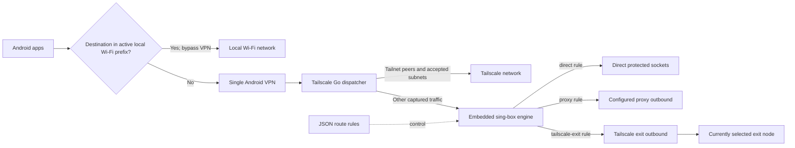

# tailsing

**tailsing** is an experimental Android app combining Tailscale connectivity with embedded sing-box routing. It uses one Android VPN and lets JSON rules send captured Internet traffic direct, through a configured proxy, or through the currently selected Tailscale exit node. Tailscale peer and accepted-subnet traffic stays on Tailscale.

## Status

Live tests were run on a Xiaomi device running Android 16.

### Works during the tests

- Direct HTTP and SOCKS5 TCP requests work. An unavailable SOCKS proxy blocks the tested request instead of falling back to direct; reapplying the working profile restores new requests.
- HTTP through the selected Tailscale exit works and reported the same public IP as stock Tailscale. A domain rule can select that exit.
- Tailnet HTTP and IPv6 TCP work alongside the exit route. MagicDNS and public DNS queries also work.
- Exact and regex package rules, UID rules, and Wi-Fi `network_type` rules pass live checks. Nonmatching package and port controls block as expected.
- The Android build and 72 Android unit tests pass. The host routing, TUN, and SOCKS fixture checks pass.

### Unsupported

- Wi-Fi SSID and BSSID conditions are rejected explicitly.
- Process-name, process-path-regex, and user conditions lack Android process-path/username metadata.
- Rules can use only the one exit node currently selected in Tailscale.

### Not yet verified

- General Android UDP traffic through a proxy or exit, and public IPv6 Internet through an exit. The observed UDP DNS checks use the app's DNS interception and do not establish general UDP forwarding.
- Live cellular routing and Wi-Fi/cellular handover.
- Live metered and Data Saver conditions; host tests cover these metadata changes, but only Wi-Fi `network_type` was tested on-device.
- Automatic recovery of existing flows after a route change; recovery checks used new requests or explicit profile reapplication.
- Package routing between separate third-party apps, sustained throughput, and battery use.

## Data flow



## Build and tests

Use Go 1.27.3, JDK 21, Android SDK platform 36, build-tools 36.0.0, and NDK 27.2.12479018. The Android build currently targets ARM64 only. Set `JAVA_HOME` and `ANDROID_HOME` to your installed JDK and Android SDK.

From the repository root:

```sh
export ANDROID_NDK_HOME="$ANDROID_HOME/ndk/27.2.12479018"
export GOBIN="$PWD/android/build/go/bin"
export PATH="$JAVA_HOME/bin:$GOBIN:$PATH"
export GOTOOLCHAIN=local
mkdir -p "$GOBIN" android/libs
go install golang.org/x/mobile/cmd/gomobile golang.org/x/mobile/cmd/gobind
go run tailscale.com/cmd/mkversion > tailscale.version
gomobile bind -target android/arm64 -androidapi 26 \
  -tags ts_omit_cachenetmap,with_gvisor,with_quic,with_utls,with_wireguard \
  -ldflags="$(./version-ldflags.sh) -checklinkname=0 -linkmode=external -extldflags=-Wl,-z,max-page-size=16384" \
  -o android/libs/libtailscale.aar ./libtailscale
(cd android && ./gradlew --no-daemon --max-workers=2 assembleDebug testDebugUnitTest ktfmtCheck)
```

The debug APK is written to `android/build/outputs/apk/debug/android-debug.apk`.

Run the host routing checks from the repository root:

```sh
export GOMAXPROCS=2
go test -tags with_gvisor,with_quic,with_utls,with_wireguard \
  ./libtailscale/routing ./libtailscale/ifaceparse ./libtailscale/ranges_calc -count=1
go test libtailscale/network_callback.go libtailscale/callbacks_test.go -count=1
```

The portable TUN driver tests run separately because the full `libtailscale` package uses Android-only APIs:

```sh
driver_test_dir="$(mktemp -d)"
trap 'rm -rf -- "$driver_test_dir"' EXIT
cp libtailscale/multitun.go libtailscale/multitun_test.go "$driver_test_dir/"
printf 'package libtailscale\nconst defaultMTU = 1280\n' > "$driver_test_dir/mtu.go"
go test "$driver_test_dir/multitun.go" "$driver_test_dir/multitun_test.go" \
  "$driver_test_dir/mtu.go" -count=1
```

Configure routing in the app's JSON routing settings. User configuration supplies outbounds and route rules; the app manages the Android TUN inbound. Treat proxy credentials in routing profiles as private.

## Project history and licenses

This standalone repository retains the full upstream Tailscale Android Git history and adds the sing-box integration.

- [Upstream Tailscale Android README](README.upstream.md) is preserved separately.
- The repository retains the upstream Tailscale BSD-3-Clause license in [LICENSE](LICENSE). The sing-box v1.14.4 engine is licensed under [GPL-3.0-or-later](https://github.com/SagerNet/sing-box/blob/v1.14.4/LICENSE); dependencies may carry additional license terms.

## Branding and operations

The launcher and About screen use the tailsing network-cube logo. The app keeps package ID `com.tailscale.ipn.singbox` so updates retain existing registration and settings.
